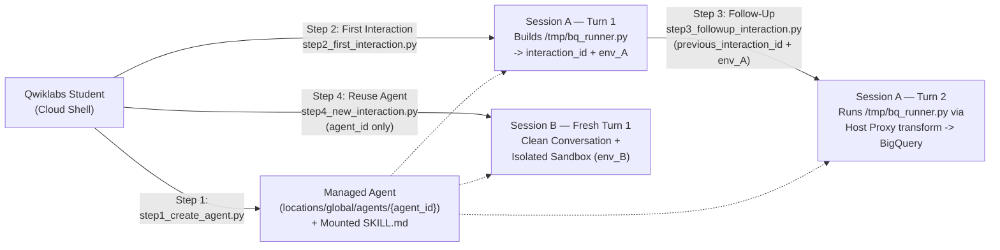

# Managed Agents API & Interactions API Lab

This lab runs **100% standalone in a fresh, empty Qwiklabs Google Cloud environment**—no containers to build, no MCP servers required from other labs, and no pre-existing Skill Registry resources needed:
- **Bundled Skill (`./skills/data-analytics/SKILL.md`):** Included directly in this directory and automatically staged to Cloud Storage (`gs://<PROJECT_ID>-managed-agent-skills/data-analytics/SKILL.md`) by `./instructions.sh` and `step1_create_agent.py`. Defines canonical Google Analytics metric formulas (`bounce_rate`, `monthly_active_users`), `_TABLE_SUFFIX` partition rules, and an immutable `<!-- PROTECTED:START -->` SQL governance block.
- **Public Dataset (`bigquery-public-data.google_analytics_sample.ga_sessions_*`):** Globally available in every Qwiklabs project out-of-the-box.
- **Zero-Secret BigQuery Sandbox Execution:** The Managed Agent writes, self-tests, and runs `/tmp/bq_runner.py` inside `code_execution`, while outbound calls to `bigquery.googleapis.com` are authenticated at the **host egress proxy** (`network.allowlist[].transform`) so **zero OAuth tokens ever enter sandbox memory, disk, or env vars**.

---

## Lab Overview: 4 Explicit Steps

| Step | Script | API Operation | State Passed In $\rightarrow$ Saved Out |
| :--- | :--- | :--- | :--- |
| **Step 1** | [`step1_create_agent.py`](step1_create_agent.py) | **Create Managed Agent**<br>`client.agents.create(...)` | Mounts [`skills/data-analytics/SKILL.md`](skills/data-analytics/SKILL.md) + `code_execution` $\rightarrow$ saves **`agent_id`** |
| **Step 2** | [`step2_first_interaction.py`](step2_first_interaction.py) | **First Interaction with Agent**<br>`client.interactions.create(agent=agent_id, ...)` | Uses `agent_id` $\rightarrow$ looks up `bounce_rate` & `_TABLE_SUFFIX` rules (zero BQ scan), builds `/tmp/bq_runner.py`, saves **`interaction_id`** + **`environment_id`** |
| **Step 3** | [`step3_followup_interaction.py`](step3_followup_interaction.py) | **Follow Up on Previous Interaction**<br>`client.interactions.create(agent=agent_id, previous_interaction_id=..., environment={..., "environment_id": ...})` | Chains Step 2's **`previous_interaction_id`** (conversation memory) + **`environment_id`** (sandbox disk with `/tmp/bq_runner.py`) + proxy `transform` auth to query `ga_sessions_20170801` |
| **Step 4** | [`step4_new_interaction.py`](step4_new_interaction.py) | **New Interaction with Existing Agent**<br>`client.interactions.create(agent=agent_id, ...)` | Reuses **`agent_id`** from Step 1 while **omitting** `previous_interaction_id` and `environment_id` $\rightarrow$ starts a fresh conversation and clean, isolated sandbox (`new_env_id != step2_env_id`) |



---

## Task 0: Environment Setup (Fresh Qwiklabs Project)

In Cloud Shell, navigate to `managed-agents-api` and run the setup script:

```bash
cd managed-agents-api
chmod +x instructions.sh
./instructions.sh
```

`instructions.sh` enables `aiplatform.googleapis.com`, `bigquery.googleapis.com`, and `storage.googleapis.com`, configures student and service-agent IAM roles, uploads the bundled [`skills/data-analytics/SKILL.md`](skills/data-analytics/SKILL.md) to `gs://<PROJECT_ID>-managed-agent-skills`, writes `.env`, and installs `google-genai>=2.4.0`.

*(Optional `<2s` offline verification before calling Google Cloud APIs: `pytest test_managed_agent.py`)*

---

## Task 1: Create the Managed Agent (`step1_create_agent.py`)

Provision your reusable Managed Agent on the control plane (`locations/global`):

```bash
python step1_create_agent.py
```

**What this step does:**
- Stages [`skills/data-analytics/SKILL.md`](skills/data-analytics/SKILL.md) to `gs://<PROJECT_ID>-managed-agent-skills` and calls `client.agents.create(...)` with `base_agent="antigravity-preview-05-2026"`, `tools=[{"type": "code_execution"}]`, and `base_environment` (`type="remote"`, `sources=[{"type": "gcs", ...}]`).
- Polls the CreateAgent LRO until the `base_environment` snapshot is ready (typically ~5 minutes on first creation) and saves `agent_id` to `.lab_state.json` for Tasks 2–4.

---

## Task 2: Run Your First Interaction (`step2_first_interaction.py`)

Invoke your Managed Agent through the **Interactions API** (`client.interactions.create(agent=agent_id, stream=True, ...)`):

```bash
python step2_first_interaction.py
```

**What this step does:**
- Streams SSE events (`interaction.created`, `step.start`, `step.delta`, `interaction.completed`) as the agent:
  1. Reads the official `bounce_rate` SQL formula and `ga_sessions_*` `_TABLE_SUFFIX` partition key from its mounted `SKILL.md` (**zero BigQuery scan**).
  2. Writes `/tmp/bq_runner.py` (mirrored to `./bq_runner.py`) inside `code_execution` and runs a local Python self-test proving `SELECT *` and unpartitioned queries are rejected before any HTTP call.
- Inspects the remote workspace snapshot via `client.environments.files.list()` and saves **both** `interaction_id` and `environment_id` to `.lab_state.json`.

---

## Task 3: Follow Up on the Previous Interaction (`step3_followup_interaction.py`)

Continue the **same conversation and sandbox** from Task 2:

```bash
python step3_followup_interaction.py
```

**What this step does:**
- Passes **`previous_interaction_id`** (from Task 2) so the agent remembers the `bounce_rate` formula from the prior turn without repeating it.
- Passes **`environment_id`** (from Task 2) so `/tmp/bq_runner.py` is already present on disk inside the `7-day` Linux sandbox.
- Attaches a short-lived BigQuery OAuth header on the **host egress proxy** (`network.allowlist[].transform`)—keeping zero credentials inside sandbox env vars or disk—and executes `/tmp/bq_runner.py` against `bigquery-public-data.google_analytics_sample.ga_sessions_*` (`_TABLE_SUFFIX = '20170801'`), reporting `dry_run_bytes` (`<= 100 MB`), `bounce_rate`, and top 3 `trafficSource.source` counts.

---

## Task 4: Create a New Interaction with the Existing Agent (`step4_new_interaction.py`)

Reuse the **same `agent_id`** from Task 1 for a completely separate request—without calling `client.agents.create` again and without leaking Task 2/3 state:

```bash
python step4_new_interaction.py
```

**What this step does:**
- Calls `client.interactions.create(agent=agent_id, ...)` while **explicitly omitting** `previous_interaction_id` and `environment_id`.
- Confirms:
  1. The agent immediately uses its mounted `SKILL.md` to return the canonical `monthly_active_users` (`COUNT(DISTINCT fullVisitorId)`) formula.
  2. `previous_interaction_id` is `None` (clean conversation history).
  3. A brand-new isolated sandbox (`Session B environment_id != Session A environment_id`) is provisioned where Task 2's `/tmp/bq_runner.py` does not exist.

---

## Task 5: Clean Up Resources (`cleanup_managed_agent.py`)

Delete the Managed Agent and both remote sandboxes created during Tasks 1–4:

```bash
python cleanup_managed_agent.py
```

*(Bonus optional comparison: run `python low_infra_harness.py` to compare thin model-only `previous_interaction_id` prefix caching vs. `store=False` Zero Data Retention on `gemini-3.8-flash`.)*
